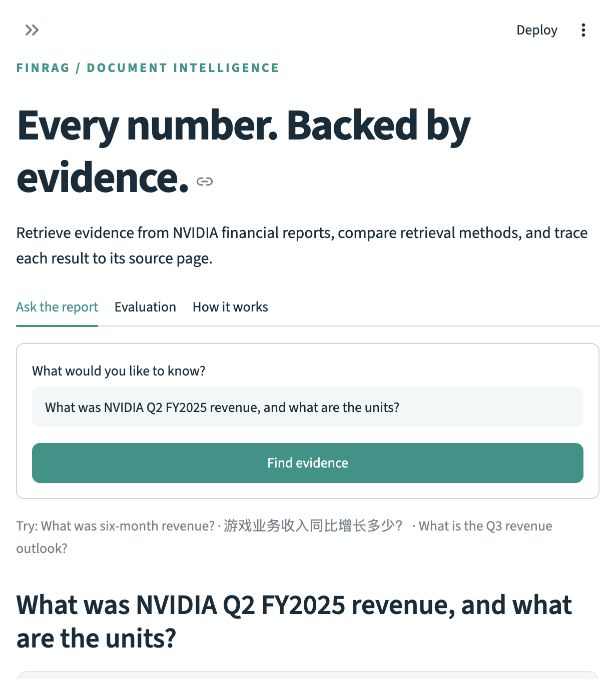
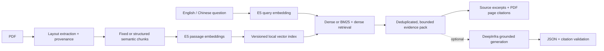

# FinRAG — Financial Document QA

A reproducible LangChain project for retrieving evidence from financial reports. It combines multilingual embeddings, layout-aware semantic chunking, hybrid search, and page-level citations, with optional DeepInfra generation and HyDE retrieval.

**Status:** the local retrieval workflow is implemented and tested. DeepInfra generation, HyDE, and model-comparison code are implemented but have **not** been validated against the live API. Without a key, the app returns source evidence rather than a generated answer.

## Demo



```bash
# Run from the project directory, using the existing virtual environment.
.venv/bin/python -m streamlit run app.py
```

Open **http://127.0.0.1:8501**. The interface is in English and accepts English or Chinese questions. The server binds only to the local machine. Press Ctrl+C in its terminal to stop it.

Try:

- What was NVIDIA's Q2 FY2025 revenue, and what are the units?
- 游戏业务第二季度收入及同比增长率分别是多少？
- What was revenue for the six months ended July 28, 2024?
- What is the Q3 FY2025 revenue outlook and its tolerance?
- How many full-time employees did NVIDIA have? — a useful unanswerable example for this report.

The sample corpus is NVIDIA's nine-page FY2025 Q2 earnings release. The fiscal quarter ended **July 28, 2024**; fiscal-year labels and calendar dates are intentionally kept distinct.

## Measured retrieval results

The evaluation set contains 38 manually authored questions: 10 answerable + 2 unanswerable development questions, and 22 + 4 test questions.

| Pipeline | All-required-evidence coverage @5 | Successful test questions |
|---|---:|---:|
| Fixed-size chunks + dense retrieval | 59.1% | 13 / 22 |
| Structured semantic chunks + dense retrieval | 81.8% | 18 / 22 |
| Structured semantic chunks + hybrid retrieval | 90.9% | 20 / 22 |

The structured semantic variant improves this metric by **22.7 percentage points** over the baseline. This measures **retrieved evidence**, not generated-answer accuracy. The improvement bundles layout handling, context preservation, and semantic boundaries; it is not a single-variable ablation.

The dataset is small, comes from one report, and was authored by the implementer. These results do not establish cross-company generalization or production performance. Unanswerable questions are reported separately, not included in the answerable denominator. Failed cases are retained.

- [Evaluation report and failures](reports/retrieval-test.md)
- [Per-question evidence and scores](reports/retrieval-test.json)
- [Methodology and limitations](docs/EVALUATION.md)

**No claim of “15% improvement from HyDE” is supported yet.** Live HyDE experiments and LLaMA/Mistral cost–quality comparisons remain pending API access.

## Architecture



HyDE adds a separate optional query path: question → hypothetical passage → passage embedding → retrieval of **real** source chunks. The hypothetical text is never used as answer evidence.

## Implementation decisions

| Component | Implementation and rationale |
|---|---|
| Extraction | `pypdf` layout extraction; physical PDF page numbers, document period, URL, and SHA-256 provenance |
| Chunking | Fixed-size baseline; adjacent-sentence embedding distances for prose boundaries; repeated table headers and units |
| Embeddings | `intfloat/multilingual-e5-small`, 384 dimensions, `query:` / `passage:` prefixes, normalized vectors, explicit length checks |
| Retrieval | Exact NumPy cosine search; optional BM25 with reciprocal rank fusion; document filtering |
| Persistence | JSON + NPY without pickle; integrity hashes, model/config checks, and atomic promotion of index generations |
| Context | Complete chunks, exact deduplication, explicit UTF-8 byte budget, and source IDs |
| Generation | Optional DeepInfra adapter, bounded output, finite retries, usage/latency reporting, and configurable cost estimates |
| Observability | SQLite embedding cache and local events that omit plaintext questions, evidence, and credentials |
| Evaluation | Evidence groups independent of chunk IDs; Hit@k, all-evidence coverage, evidence recall, MRR, and failure inspection |

LangChain is used for `Document`, the `Embeddings` interface, text splitting, `ChatPromptTemplate`, and runnable composition. The small exact-search index is deliberately inspectable; this project does not claim to use Chroma, FAISS, or a large-scale ANN service.

## Quick start on a new machine

Use Python 3.12 and run from the project directory:

```bash
python3.12 -m venv .venv
.venv/bin/python -m pip install -r requirements.txt
.venv/bin/python scripts/download_model.py
.venv/bin/finrag index
.venv/bin/python scripts/validate.py
.venv/bin/python -m streamlit run app.py
```

Initial dependency/model downloads require internet access. The model is approximately 470 MB; the full Python environment requires additional space. After download, local indexing, retrieval, and evaluation run offline.

The model revision is pinned. `requirements.lock.txt` records the tested macOS arm64 / Python 3.12 environment; other platforms may require dependency resolution from `pyproject.toml` and fresh validation.

## CLI

```bash
# Inspect local setup without paid API calls.
.venv/bin/finrag doctor

# Inspect extraction, then rebuild indexes after corpus/config changes.
.venv/bin/python extract_pdf.py
.venv/bin/finrag index

# Retrieve source evidence.
.venv/bin/finrag ask "What was revenue for the six months ended July 28, 2024?"
.venv/bin/finrag ask "游戏业务收入是多少？" --strategy hybrid --json

# Reproduce local evaluation and verification.
.venv/bin/finrag evaluate --split dev
.venv/bin/finrag evaluate --split test
.venv/bin/python scripts/validate.py
```

Evaluation commands overwrite the corresponding report filenames. Archive reports and record configuration changes before starting a new experiment.

## Optional DeepInfra setup

Copy `.env.example` to `.env` and enter the key **locally**. Set `DEEPINFRA_MODEL` to an exact current model ID from the provider's catalog. Keys are excluded from version control.

```bash
# These commands make paid API calls once credentials are configured.
.venv/bin/finrag ask "What was Q2 FY2025 revenue?" --generate
.venv/bin/finrag ask "What was Q2 FY2025 revenue?" --strategy hyde --allow-remote --generate
.venv/bin/finrag evaluate --split dev --hyde --allow-remote --limit 3
```

For model comparisons, populate `config/remote_models.json`, then run `finrag benchmark --allow-remote --limit 3`. Unknown pricing remains `null`, and human quality scores remain blank until reviewed. See [remote validation instructions](docs/DEEPINFRA.md).

## Repository map

```text
app.py                      Streamlit demo
extract_pdf.py              Minimal extraction walkthrough
src/finrag/
  config.py                 Project configuration
  ingest.py                 PDF extraction and provenance
  chunking.py               Fixed and structured semantic chunking
  embeddings.py             Local E5 adapter and vector cache
  index.py                  Versioned vector persistence
  retrieval.py              Dense retrieval, BM25/RRF, context packing
  pipeline.py               LangChain orchestration, HyDE, answer checks
  remote.py                 Optional DeepInfra transport
  evaluation.py             Retrieval evaluation and model comparison
  cli.py                    Command-line interface
config/                     Corpus, model, and chunking configuration
evals/questions.json        Questions, reference answers, evidence groups
tests/                      Unit, mocked API, and real-model integration tests
reports/                    Actual evaluation outputs
docs/                       Architecture, limitations, and learning materials
data/                       Local model, indexes, extracted text, and cache
logs/events.jsonl           Local operational events
```

## Adding documents

Place a text-based PDF inside the project and add an entry to `config/corpus.json` with a unique `doc_id`, relative `file`, `title`, explicit `period`, official `source_url`, and optionally `sha256`. Run `finrag index` to rebuild both indexes.

The current table rules target this report family. Inspect extracted pages and chunks before trusting a new layout. Scanned/encrypted PDFs and pages without sufficient extractable text fail explicitly. The demo limits each file to 50 MB and 500 pages.

## Reliability boundaries

- Similarity is not confidence. Unanswerable questions can score highly; local mode makes no automatic answerability claim.
- Table extraction is heuristic. Some footnote tables and cross-page row labels remain ambiguous and require the original PDF.
- Citation-ID validation does not prove factual correctness or faithfulness.
- Context budgets are measured in UTF-8 bytes, not exact provider tokens.
- Reported warm-cache timings exclude model loading and first-time query encoding; they are not an online SLA.
- This is a single-user engineering prototype. Public deployment, authentication, tenant isolation, OCR, incremental indexing, and scale testing remain future work.

See [bottlenecks and targeted questions](docs/BOTTLENECKS.md) and the [verification record](docs/VERIFICATION.md).

## References

- [Multilingual E5 model card](https://huggingface.co/intfloat/multilingual-e5-small): prefixes, normalization, and length limits.
- [HyDE paper](https://arxiv.org/abs/2212.10496): hypothetical passages as a retrieval aid.
- [DeepInfra Chat API](https://docs.deepinfra.com/chat/overview): endpoint and model configuration.
- [pypdf extraction documentation](https://pypdf.readthedocs.io/en/stable/user/extract-text.html): layout extraction and PDF/OCR limitations.
- [LangChain Runnable implementation](https://github.com/langchain-ai/langchain/blob/master/libs/core/langchain_core/runnables/base.py): pipeline composition.
- User-supplied course slides, `RAG-intro.pptx` and `presentation_project_rag.pptx`, informed the learning sequence; synced originals remain read-only.

The source financial report is owned by NVIDIA. Model weights retain their upstream license. Always consult the original report when verifying financial claims.
